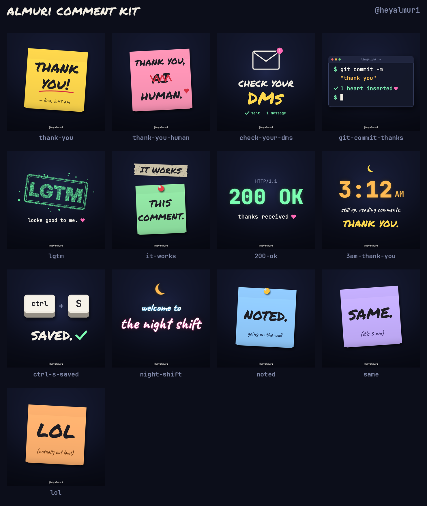

# Comment kit

Reply images in Lina's style for answering Instagram comments: sticky notes, a terminal, a rubber stamp, a neon sign. Every reply comes as a still, an animation and, for most of them, a cut-out sticker.



| Folder | What | Size |
|---|---|---|
| `gif/` | looping animations, 3 to 4.6 s | 540 × 540, all under 1 MB |
| `png/` | still of the last frame, night background | 1080 × 1080 |
| `stickers/` | transparent cut-outs, for Stories or on top of photos | up to 1080 px |

## Which one to use

| Reply | Use it when someone… |
|---|---|
| `thank-you` | leaves any kind comment. The default. |
| `thank-you-human` | says something genuinely helpful. Lina thanks the AI out of habit, crosses it out and writes "human". |
| `check-your-dms` | comments the post's keyword (REPO and so on). Post it once the message has gone out. |
| `git-commit-thanks` | is a developer being nice. |
| `200-ok` | sends support and you want a short "got it, thanks". |
| `3am-thank-you` | comments late at night, or says they watch at night. |
| `lgtm` | approves: "this is so real", "accurate", "10/10". |
| `it-works` | writes the best comment under the post. It goes in the "it works" row. |
| `ctrl-s-saved` | says they saved or bookmarked the post. |
| `night-shift` | is commenting for the first time, or just followed. |
| `noted` | suggests an episode, a tool or a fix. |
| `same` | posts something relatable ("this is me every night"). |
| `lol` | makes a joke in the comments. |

## Getting them into Instagram

- **Comments.** Instagram's GIF button in comments only searches GIPHY, and you can't add a GIF from your camera roll there. To make these searchable, upload the `gif/` files to a GIPHY brand channel. GIPHY has to approve the channel first. Its application asks for at least 5 uploads, a branded avatar and a link to your own website domain (a social profile doesn't count, and a GitHub page probably doesn't either). Tag every upload `almuri` and `heyalmuri`, plus the reply's words, so typing "almuri" in the comment GIF search lists the whole kit. Check GIPHY's current rules before you apply.
- **DMs.** Send the `png/` stills from your camera roll. `check-your-dms` and `thank-you` work well there.
- **Stories.** Add a `stickers/` file with the photo sticker. `lgtm` and `ctrl-s-saved` have a dark outline, so their light text stays readable on bright photos.

## Changing the text or adding a reply

Everything is drawn by `make_kit.py`. No image files are edited by hand.

```sh
python3 make_kit.py                 # rebuild everything and preview.png
python3 make_kit.py thank-you lol   # rebuild only these
```

Each reply is one `scene_*` function, listed in `SCENES` at the bottom with its length in seconds. The words sit at the top of each function, so a wording change is a one-line edit. You need Python 3 with Pillow and numpy, plus ffmpeg. On first run the script downloads Permanent Marker (Apache 2.0) and Caveat (SIL OFL) from github.com/google/fonts into `.fonts/`, which git ignores. JetBrains Mono and Inter (both SIL OFL) must be installed on the system. On another machine, change the paths in `SYSTEM_FONTS`.

The colours sit under `# palette` at the top of the script: night navy, five sticky-note colours, mint, amber and neon pink and blue.
